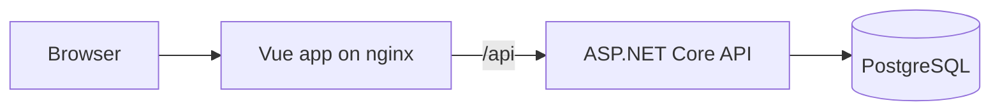
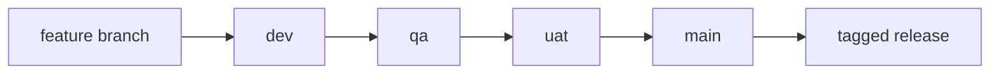

# Leads Tracker

A lead capture form and filterable dashboard, built to practise the full delivery cycle: from a Vue UI and ASP.NET Core API to automated tests, gated branch promotion, manual UAT approval and tagged releases.

## Features

- Create leads with client and server validation
- Filter by status, lead source, industry, owner and created date
- Search across name, company and email
- See totals by status that follow the current filters
- Page through results on the server
- Reject duplicate emails, regardless of letter case

## Tech stack

| Area | Technology |
| --- | --- |
| UI | Vue 3, Vite |
| API | ASP.NET Core on .NET 10, EF Core |
| Database | PostgreSQL 16 in Docker |
| API tests | xUnit, WebApplicationFactory |
| Browser tests | Selenium WebDriver, headless Chrome |
| CI/CD | GitHub Actions, GitHub Environments |

## Architecture



## Delivery pipeline



| Pull request into | Required before merge |
| --- | --- |
| `dev` | API tests and web build |
| `qa` | Adds Selenium tests against the full app in Docker |
| `uat` | Adds manual approval from a named reviewer |
| `main` | API and Selenium tests; merging creates a tagged release |

All four branches are protected, and the rules apply to administrators too.

## Testing

- **10 API integration tests** run against real PostgreSQL. They cover validation, case-insensitive duplicate emails, combined filters, wildcard-safe search and pagination.
- **6 Selenium tests** drive Chrome through the full stack. They cover creating a lead, form errors, the duplicate email message, filters with totals, pagination and the empty state.

## Design decisions

- **The database enforces unique emails.** Checking before inserting leaves a race between two requests, so the API turns the unique index error into a `409 Conflict`.
- **Emails are saved in lowercase.** PostgreSQL compares text case-sensitively, so this stops `Maya@x.com` and `maya@x.com` from both being accepted.
- **Totals and the list share one filtered query.** They can't disagree, and the total comes from the status counts.
- **Paging sorts by date, then ID.** This keeps rows from repeating across pages when timestamps match.
- **The dashboard cancels outdated searches.** A slow older response can't replace newer results.
- **Selenium uses `data-testid` and explicit waits.** Tests don't depend on styling or fixed delays.

## Run it locally

You need the .NET 10 SDK, Node.js and Docker Desktop.

```powershell
docker compose up -d
dotnet tool install --global dotnet-ef
dotnet ef database update --project src\LeadsTracker.Api
dotnet run --project src\LeadsTracker.Api -- --urls http://localhost:5080
```

In a second terminal:

```powershell
npm install --prefix web
npm run dev --prefix web
```

Open http://localhost:5173/.

## Run the tests

Run the API tests with the database from `docker compose up -d` running:

```powershell
dotnet test
```

Run the Selenium tests against the full stack:

```powershell
docker compose -f docker-compose.e2e.yml up -d --build
dotnet test tests\LeadsTracker.E2E
docker compose -f docker-compose.e2e.yml down
```

The database password in this repo is for local and CI test use only.
